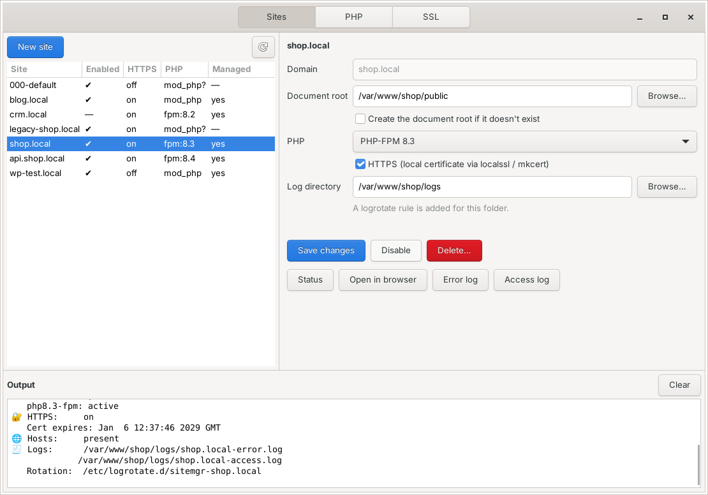
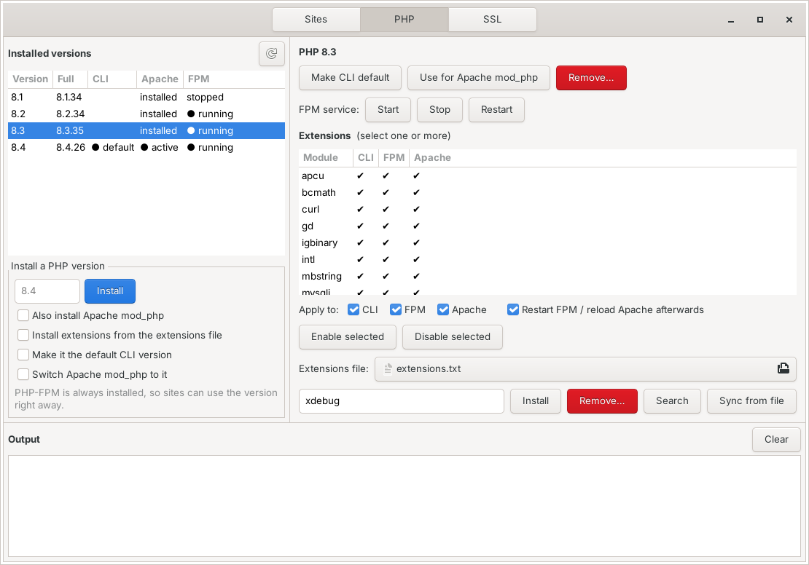
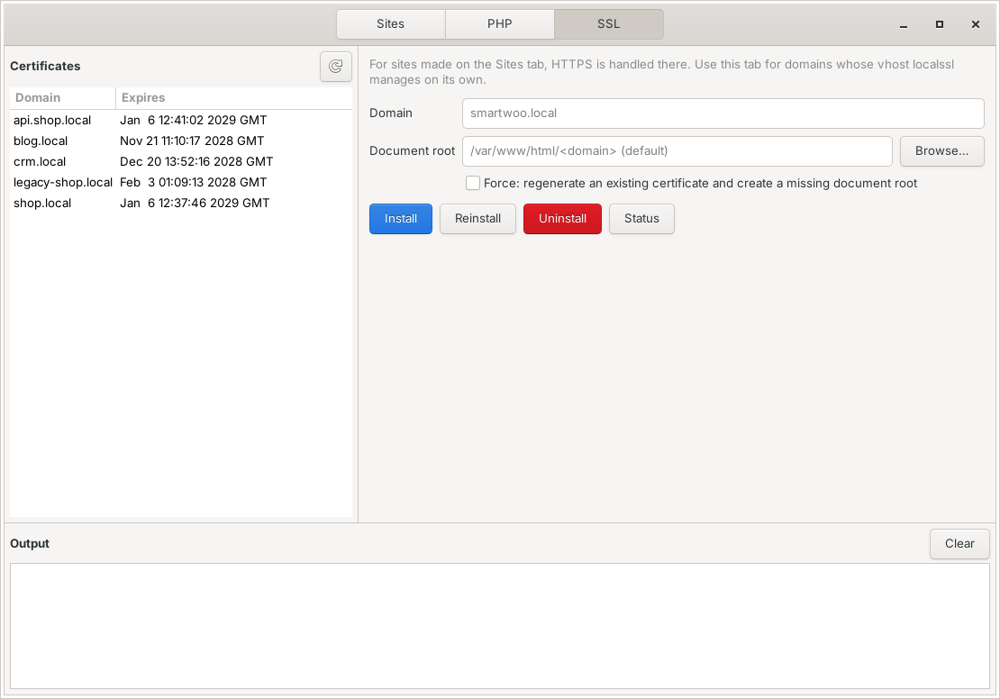
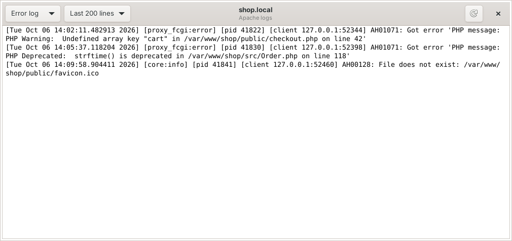

# Callismart Dev Manager

A desktop app for running local PHP development sites on Apache (Debian / Ubuntu).



- **Sites** — create, edit, enable/disable, adopt and delete Apache vhosts. Each site picks its own PHP:
  Apache's global mod_php, or a specific PHP-FPM version, side by side. Optional HTTPS and an
  `/etc/hosts` entry. Per-site log directory of your choice and a built-in error/access log viewer.
- **PHP** — install and remove PHP versions, switch the CLI and mod_php version, start/stop FPM,
  enable/disable/install extensions per SAPI, and sync extensions from a list file you choose
  (one extension name per line; the choice is remembered).
- **SSL** — local certificates with mkcert for domains whose vhost you manage yourself.

The app is a thin GTK front end. Everything is done by three command-line tools that also work on their own:

| Tool       | Does                                                                 |
|------------|----------------------------------------------------------------------|
| `sitemgr`  | Apache vhosts, document roots, per-site PHP handler, HTTPS, hosts    |
| `phpmgr`   | PHP versions, FPM services, extensions (interactive menu or scripted) |
| `localssl` | mkcert certificates and simple SSL vhosts                            |

Read-only actions run as you; anything that changes the system asks for your password (pkexec).

## Screenshots

| PHP versions, FPM and extensions | Certificates |
|---|---|
|  |  |

**Per-site log viewer**



<sub>Screenshots show sample sites.</sub>

## Install

### From a release (.deb)

Download the latest `callismart-devmgr_<version>_all.deb` from the
[Releases](../../releases) page, then:

```bash
sudo apt install ./callismart-devmgr_<version>_all.deb
```

`apt` installs the dependencies (Apache, GTK bindings, pkexec) and recommends `mkcert`.

### From source

```bash
git clone https://github.com/CallismartLtd/callismart-devmgr.git
cd callismart-devmgr
sudo make install            # installs to /usr/local; PREFIX=/usr to change
```

Dependencies when installing from source:

```bash
sudo apt install apache2 python3-gi gir1.2-gtk-3.0 pkexec mkcert libnss3-tools
```

Then trust the mkcert CA once, as your normal user (not with sudo):

```bash
mkcert -install
```

## Requirements

- Debian or Ubuntu with Apache 2.4
- PHP from the [ondrej/php](https://launchpad.net/~ondrej/+archive/ubuntu/php) PPA for multiple versions
  (`phpmgr install` needs it)
- Document roots must live under `/var/www/`

## Command-line usage

```bash
sitemgr list
sudo sitemgr create --domain shop.local --docroot /var/www/shop/public --php fpm:8.3 --create-docroot
sudo sitemgr edit --domain shop.local --php mod_php --no-ssl
sudo sitemgr edit --domain shop.local --log-dir /var/www/shop/logs   # logs next to the project
sudo sitemgr adopt --domain old.local        # take over an existing vhost

phpmgr                                       # interactive menu
phpmgr list
phpmgr --yes use-cli install 8.4             # scripted, no prompts
phpmgr --ext-file ~/php-exts.txt ext sync 8.4   # extensions file anywhere (default ~/.phpmgr/extensions.txt)

sudo localssl install --domain blog.local
localssl list
```

Each tool has `--help`.

## Notes

- `sitemgr` rewrites the vhosts it manages from its own template. Custom directives in an adopted
  vhost are dropped; the original is backed up to `/var/backups/sitemgr/`.
- Every vhost change is checked with `apache2ctl configtest` and rolled back if Apache rejects it.
- Logs go to `/var/log/apache2` unless you set a log directory for the site. A custom directory gets
  its own logrotate rule (`/etc/logrotate.d/sitemgr-<domain>`). Prefer a folder *next to* the
  document root (e.g. `/var/www/shop/logs`): anything inside the docroot is web-reachable, so if you
  do put logs there, sitemgr adds a rule that stops Apache serving that folder.
- Do not use `phpmgr fpm use` when sites run on different FPM versions — it stops all other FPM services.

## Uninstall

```bash
sudo apt remove callismart-devmgr      # if installed from .deb
sudo make uninstall                    # if installed from source
```

Your sites, certificates and `/etc/hosts` entries are left in place.

## License

[MIT](LICENSE)
